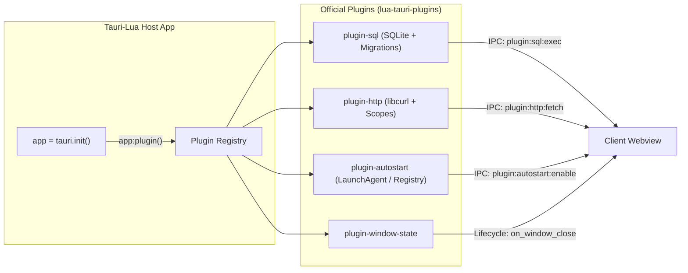

# Tauri-Lua Plugins Workspace 🔌

> **Official modular plugins for the [Tauri-Lua](https://github.com/MoxPy/lua-tauri) desktop framework.**

[](./LICENSE)
[](https://github.com/tauri-apps/plugins-workspace)
[](https://github.com/MoxPy/lua-tauri)

This monorepo hosts high-performance, plug-and-play extensions for Tauri-Lua, modeled directly after the official [Tauri 2 plugins workspace](https://github.com/tauri-apps/plugins-workspace). Each plugin provides seamless 1:1 guest JavaScript/TypeScript APIs, native OS integrations, and enterprise-grade defensive cybersecurity.

---

## Available Plugins

| Plugin | Description | Drivers & Features | Status |
| :--- | :--- | :--- | :---: |
| [**`sql`**](./plugins/sql) | **Multi-Database SQL Engine:** Transactional schema migrations (`_sqlx_migrations`), prepared statements with parameterized binds (`$1, $2`, `?`), connection pooling, and automatic AppData sandboxing. | **SQLite3** (Native FFI, `:memory:`), **PostgreSQL**, **MySQL** | ✅ Production |
| [**`http`**](./plugins/http) | **Native `libcurl` Client:** Complete CORS bypass for desktop frontends, native OS SSL/TLS certificate validation, connection pooling, and strict `allow`/`deny` URL scope enforcement. | Native `libcurl` (HTTP/1.1, HTTP/2) | ✅ Production |
| [**`autostart`**](./plugins/autostart) | **Launch at System Login:** macOS LaunchAgent `.plist` (`~/Library/LaunchAgents`), Linux XDG Autostart (`~/.config/autostart`), and Windows User Registry (`HKCU\...\Run`). | Native OS Startup Handlers | ✅ Production |
| [**`window-state`**](./plugins/window-state) | **Window State Persistence:** Automatically remembers and restores window dimensions, coordinates, and maximize/fullscreen states across restarts via `on_window_close` hook. | OS Window Rect & State Cache | ✅ Production |
| **`websocket`** | High-throughput client WebSockets with binary streaming and auto-reconnect. | Native C WebSocket Engine | 🚧 Planned |
| **`log`** | Structured file and console logging with automatic log rotation and syslog integration. | Native Log Streamer | 🚧 Planned |

---

## Architecture Overview



---

## How Plugins Work in Tauri-Lua

Tauri-Lua features automatic module resolution. When this repository is placed alongside `lua-tauri` (or plugins are installed into `src-tauri/plugins/`), the runtime detects all plugins inside `plugins/` automatically without manual path configuration.

### 1. Registering Plugins in Backend (`src-tauri/src/main.lua`)

```lua
local tauri = require("tauri")
local app = tauri.init()

-- 1. Load plugins directly by name
local sql = require("sql")
local http = require("http")
local autostart = require("autostart")
local window_state = require("window-state")

-- 2. Configure SQL with Schema Migrations
app:plugin(sql.init({
    default_path = "sqlite:production.db",
    migrations = {
        {
            version = 1,
            description = "create_users_table",
            sql = "CREATE TABLE IF NOT EXISTS users (id INTEGER PRIMARY KEY AUTOINCREMENT, name TEXT NOT NULL, email TEXT UNIQUE NOT NULL);"
        },
        {
            version = 2,
            description = "add_department_column",
            sql = "ALTER TABLE users ADD COLUMN department TEXT DEFAULT 'General';"
        }
    }
}))

-- 3. Configure HTTP with Security Scopes (CORS Bypass)
app:plugin(http.init({
    scopes = {
        allow = { "https://api.github.com/*", "https://*.mycompany.com/*" },
        deny = { "https://api.github.com/admin/*" }
    }
}))

-- 4. Enable Login Autostart & Window Geometry Persistence
app:plugin(autostart.init())
app:plugin(window_state.init())

app:run()
```

---

### 2. Frontend Usage (`JavaScript / TypeScript`)

Frontend code interacts with plugins using standard Tauri 2 `@tauri-apps/plugin-*` guest APIs or pre-injected window globals:

```javascript
// ==========================================
// 1. SQL Plugin (@tauri-apps/plugin-sql parity)
// ==========================================
const db = await window.__TAURI__.sql.Database.load('sqlite:production.db');
await db.execute(
  'INSERT INTO users (name, email, department) VALUES ($1, $2, $3);',
  ['Alice', 'alice@company.com', 'Engineering']
);
const users = await db.select('SELECT * FROM users WHERE department = $1;', ['Engineering']);
console.table(users);

// ==========================================
// 2. HTTP Plugin (@tauri-apps/plugin-http parity - CORS Bypassed!)
// ==========================================
const response = await window.__TAURI__.http.fetch('https://api.github.com/zen');
if (response.ok) {
  console.log("GitHub Zen:", await response.text());
}

// ==========================================
// 3. Autostart Plugin (@tauri-apps/plugin-autostart parity)
// ==========================================
const isAuto = await window.__TAURI__.autostart.isEnabled();
if (!isAuto) {
  await window.__TAURI__.autostart.enable();
}

// ==========================================
// 4. Window State Plugin (@tauri-apps/plugin-window-state parity)
// ==========================================
const savedState = await window.__TAURI__.windowState.restore('main');
console.log("Restored dimensions:", savedState.width, savedState.height);
```

---

## Security & Defense-in-Depth

Every plugin follows strict security principles to safeguard desktop users:

1. **Zero Command Injection (`os.execute` eliminated):** Directory creation uses memory-safe C FFI (`mkdir`/`_mkdir`) and Windows Autostart uses direct Win32 `advapi32.dll` registry APIs. Shell processes (`cmd.exe`, `sh`) are completely bypassed.
2. **SQL Injection Defense (OWASP CWE-89):** Parameters are bound natively via prepared statements using `$1, $2, ...` or `?`. String concatenation is never performed.
3. **Filesystem AppData Sandboxing & Traversal Rejection:** Relative database paths are automatically sandboxed in the OS application data directory (`~/Library/Application Support/`, `%APPDATA%`, or `~/.local/share/`). Directory traversal (`..`) is strictly blocked, and arbitrary absolute paths over IPC are rejected unless explicitly whitelisted in `options.allowed_paths`.
4. **CORS Bypass with Scoped Boundaries & Redirect Verification:** The HTTP plugin completely bypasses browser CORS limitations while enforcing explicit `allow`/`deny` URL scopes. Redirects are checked on every hop to eliminate Server-Side Request Forgery (SSRF) bypasses.
5. **Protocol Allowlist & TLS Hardening:** The HTTP plugin permits only `http://` and `https://` schemes (blocking `file://`, `gopher://`, etc.). TLS certificate verification cannot be disabled by frontend callers without explicit backend authorization (`allow_insecure_tls = true`).
6. **Native OS Privilege Compliance:** Autostart configurations use per-user launch services (User Registry / LaunchAgent) with sanitized identifiers without requiring root/administrator escalation.

---

## License

MIT License. See [LICENSE](./LICENSE).
